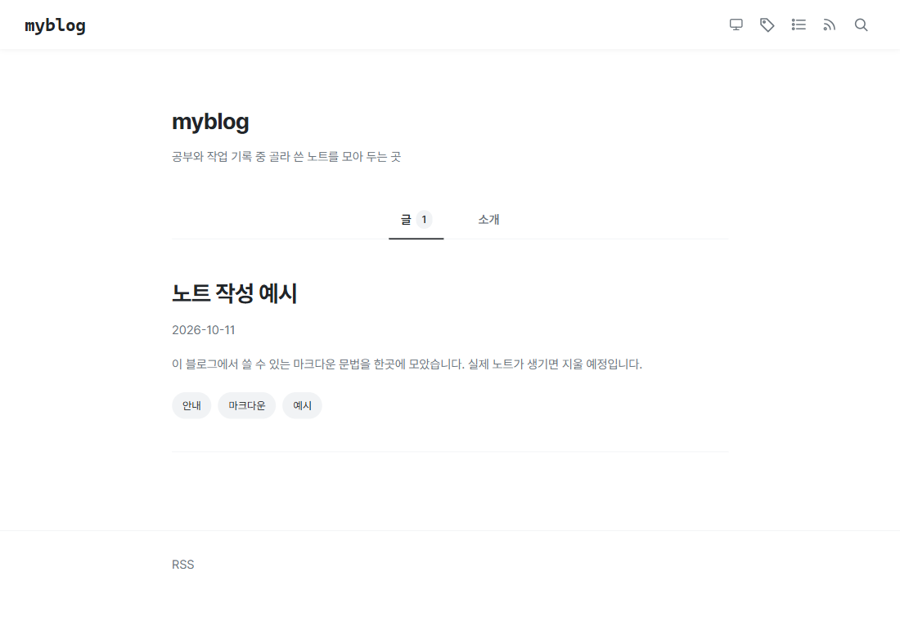
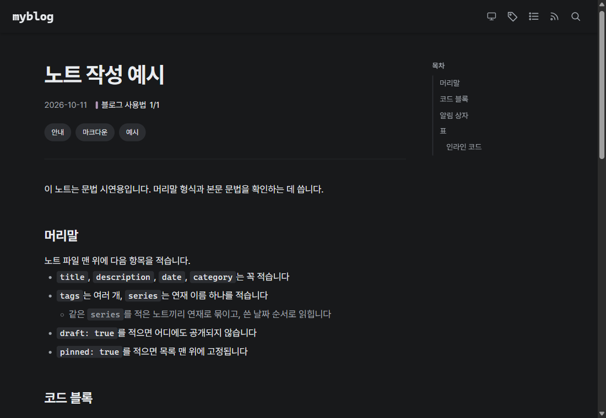

# myblog

공부와 작업 기록 중 골라 쓴 노트를 게시하는 개인 블로그입니다. Astro로 직접 만들어 GitHub Pages에 올립니다.

<p align="center">
  
  
</p>

[블로그 바로가기](https://gistone9516.github.io/myblog/) · [설계서](docs/SPEC.md) · [배포 워크플로](.github/workflows/deploy.yml)

블로그 템플릿 여섯 개(AstroPaper, Fuwari, AstroWind, PaperMod, Chirpy, Tailwind Next.js Starter)와 국내외 개발자 블로그 13곳을 조사해 장점만 골라 직접 구현했습니다. 템플릿 코드는 가져오지 않았고, 디자인은 hudi.blog 형식을 따릅니다. 동작 규칙 17개와 검증 6개는 설계서 한 곳에서 관리합니다.

<br>

## 구조

```
src/content/notes/*.md       노트 마크다운
        │
src/lib/content.ts           어댑터. 콘텐츠를 읽는 유일한 곳
        │
src/lib/notes.ts             도메인 함수. Astro를 모르는 순수 함수
        │
src/components, src/pages    화면. 도메인 함수의 결과만 그린다
        │
dist/                        정적 HTML과 Pagefind 검색 색인, GitHub Pages에 게시
```

콘텐츠를 읽는 곳은 어댑터 하나뿐이고, 정렬, 초안 제외, 연재 묶기 같은 규칙은 Astro를 모르는 순수 함수에 모았습니다. 화면마다 콘텐츠를 직접 읽으면 초안 제외나 정렬이 어딘가에서 빠지기 때문입니다. 도메인 함수는 Astro 없이 단위 테스트합니다.

검색은 서버 없이 빌드 결과물에 정적 색인을 만드는 방식을 골랐습니다. 대신 개발 서버에는 색인이 없어서 검색은 빌드한 뒤에만 확인할 수 있습니다. 그래서 `npm run verify` 하나로 테스트, 빌드, 색인 생성, 결과물 검사를 함께 돌립니다.

<br>

## 주요 문제 해결

### 1. 하위 경로 게시와 링크 깨짐

GitHub Pages의 프로젝트 저장소는 사이트가 `/myblog` 아래에 게시됩니다. 템플릿처럼 `/notes/...` 같은 루트 경로로 링크를 만들면 배포한 뒤 링크가 모두 404가 됩니다. 링크가 하나만 빠져도 그 페이지가 깨지기 때문에, 눈으로 찾아 고치는 방식으로는 막을 수 없었습니다.

**주요 변경 사항**

- 내부 링크를 만드는 함수를 `withBase` 하나로 제한
- 빌드 결과물의 모든 루트 상대 링크가 `/myblog` 안을 가리키는지 검사
- 내부 링크가 가리키는 파일이 실제로 있는지 검사

빌드할 때마다 링크 189개를 검사하고, 하나라도 어긋나면 검사가 실패합니다.

<br>

### 2. 초안 노트의 공개 차단

`draft: true`인 노트는 목록뿐 아니라 RSS, 사이트맵, 검색 색인 어디에도 나오면 안 됩니다. 화면마다 초안을 따로 거르면, 새 페이지를 만들 때 한 곳이 빠지기 쉽습니다.

**주요 변경 사항**

- 초안 제외를 콘텐츠 어댑터 한 곳에서 처리
- 확인용 초안 노트를 일부러 남겨 두고 빌드
- 결과물 HTML, XML, 검색 색인 조각에 그 노트의 주소나 제목이 있으면 실패 처리

검사 스크립트는 초안을 일부러 노출했을 때 실패하는 것까지 확인한 뒤 사용했습니다.

<br>

### 3. 콘텐츠 캐시가 지워진 CSS를 가리키는 문제

Astro는 바뀌지 않은 노트의 렌더링 결과를 캐시에서 다시 씁니다. 그래서 코드 블록 설정을 바꾸고 다시 빌드했을 때, 노트 HTML이 이미 지워진 옛 CSS 파일(`ec.pk4u8.css`)을 가리켰습니다.

**주요 변경 사항**

- 1번의 링크 검사가 존재하지 않는 CSS 참조로 잡아냄
- `--force` 빌드에서 문제가 사라지는 것을 확인해 원인을 콘텐츠 캐시로 특정
- 빌드 명령을 `astro build --force`로 고정하고 이유를 설계서에 기록

링크를 지키려고 만든 검사가 다른 종류의 결함까지 잡은 경우입니다.

<br>

### 4. 코드 블록 테마를 사이트 테마에 맞추기

이 블로그는 시스템, 밝게, 어둡게 세 가지 테마를 직접 고르게 합니다. 코드 블록이 시스템 설정만 따라가면, 사용자가 시스템과 다른 테마를 골랐을 때 코드 블록만 반대 색으로 남습니다.

**주요 변경 사항**

- `themeCssSelector`로 코드 블록 테마를 `<html data-theme>` 속성에 연결
- 시스템 설정 기반 전환(`useDarkModeMediaQuery`) 끄기
- 배경, 테두리, 강조 줄 색을 사이트 디자인 토큰과 같은 값으로 지정

테마를 바꾸면 코드 블록도 함께 바뀌고, 코드 블록만 다른 종이처럼 떠 보이지 않습니다.

<details>
<summary>설정 코드 · 색 값을 두 곳에 적는 이유</summary>

```js
expressiveCode({
  themes: ['github-light', 'github-dark'],
  themeCssSelector: (theme) => `[data-theme='${theme.type}']`,
  useDarkModeMediaQuery: false,
  styleOverrides: {
    // [어두운 테마, 밝은 테마]. tokens.css의 --surface와 같은 값
    codeBackground: ['#202124', '#ffffff'],
    borderColor: ['#2f3237', '#e9ecef'],
    frames: { frameBoxShadowCssValue: 'none' },
    // 강조 줄은 사이트의 회색 칩 색 (--accent-bg, --muted)
    textMarkers: { markBackground: ['#2b2d31', '#f1f3f5'], markBorderColor: ['#a0a6ad', '#6c757d'] },
  },
})
```

디자인 토큰은 `src/styles/tokens.css` 한 곳에만 둔다는 원칙이 있습니다. 두 곳에 적으면 디자인을 바꿀 때 한쪽만 바뀌기 때문입니다. Expressive Code 설정은 실제 색 값을 요구해서 이 원칙의 유일한 예외가 됐고, 대신 값마다 어느 토큰과 같아야 하는지 주석으로 남겼습니다.

</details>

<br>

### 5. Astro 7에서 알림 상자 문법 연결

`> [!NOTE]` 인용문을 알림 상자로 바꾸려면 remark 플러그인이 필요합니다. Astro 7의 기본 마크다운 처리기는 remark 플러그인을 받지 않습니다.

**주요 변경 사항**

- `@astrojs/markdown-remark`의 `unified` 처리기를 명시하고 플러그인 연결
- 권장되지 않는 `markdown.remarkPlugins` 대신 `markdown.processor` 설정 사용
- 알림 상자 색은 디자인 토큰만 사용

같은 문법이 GitHub 저장소와 블로그에서 똑같이 알림 상자로 보입니다.

<br>

## 검증 결과

`main`의 [`905ad95`](https://github.com/Gistone9516/myblog/commit/905ad9547ba825bb7dea23d2feca30a614ac374b)에서 `npm run verify`로 확인한 결과입니다.

| 검증 | 결과 | 근거 |
| --- | --- | --- |
| 도메인 단위 테스트 | 13개 통과 | `src/lib/notes.test.ts` |
| 빌드 | 14페이지와 검색 색인 생성 | `astro build --force && pagefind` |
| 링크 | 루트 상대 링크 189개 모두 `/myblog` 안, 대상 파일 있음 | `scripts/check-site.mjs` |
| 계층 경계 | `getCollection` 호출이 어댑터에만 있음 | 같은 스크립트 |
| 초안 제외 | 초안 1개가 결과물과 검색 색인에 없음 | 같은 스크립트 |
| 배포 | GitHub Pages 배포 성공 | [Deploy 실행](https://github.com/Gistone9516/myblog/actions/runs/38111347194) |

<br>

## 기술 스택

| 영역 | 기술 |
| --- | --- |
| Framework | Astro 7, MDX, Sitemap |
| Markdown | Expressive Code, remark-github-blockquote-alert |
| Search | Pagefind |
| Font | Pretendard (OFL) |
| Test | Vitest |
| Delivery | GitHub Actions (withastro/action), GitHub Pages |

<br>

## 주요 기능

- 연재 묶기와 연재 안 순번, 연재마다 고정된 색
- 노트당 분류 하나와 여러 태그, 각각의 색인 페이지
- 연도와 월별 아카이브, RSS, 사이트맵
- 서버 없는 전문 검색
- 시스템, 밝게, 어둡게 세 상태 테마
- 본문 옆 목차(좁은 화면에서는 접힘), 파일명과 줄 강조가 있는 코드 블록

<br>

## 실행과 문서

```powershell
npm install
npm run dev       # http://localhost:4321/myblog/ (검색은 빌드 뒤에만 동작)
npm run verify    # 단위 테스트, 빌드와 검색 색인, 결과물 검사
```

- [설계서: 동작 규칙, 계약, 검증](docs/SPEC.md)
- Node 22.12 이상이 필요합니다. 한글이나 공백이 들어간 경로에서 Node 도구가 실패한 적이 있어 영문 경로에 둡니다.
- main에 push하면 배포 워크플로가 빌드해서 게시합니다. 저장소 이름을 바꾸면 `astro.config.mjs`의 `base`와 `scripts/check-site.mjs`의 `BASE`를 같이 바꿉니다.

<details>
<summary>노트 머리말 형식 · 코드 블록과 알림 문법</summary>

`src/content/notes/`에 마크다운 파일을 만듭니다. 파일 이름이 주소가 됩니다(`/myblog/notes/파일이름/`).

```yaml
title: 제목
description: 목록에 보일 한두 줄 요약
date: 2026-10-11
category: 분류 하나
tags: [태그, 태그]
series: 연재 이름 (선택)
draft: true          # 공개하지 않음 (선택)
pinned: true         # 목록 맨 위에 고정 (선택)
```

코드 블록은 ` ```ts title="파일.ts" {3} `처럼 파일 이름과 강조 줄을 지정할 수 있고, `> [!NOTE]`, `> [!TIP]`, `> [!WARNING]`은 알림 상자가 됩니다.

</details>

<details>
<summary>폴더 구조</summary>

```
src/content/notes/      노트 마크다운. 머리말 형식은 src/content.config.ts
src/lib/content.ts      콘텐츠 어댑터. getCollection을 부르는 유일한 파일
src/lib/notes.ts        도메인 함수 (정렬, 초안 제외, 연재, 분류, 지표). Astro를 모르는 순수 함수
src/lib/notes.test.ts   도메인 단위 테스트
src/components/         화면 조각. 도메인 함수의 결과만 받아 그린다
src/layouts/            페이지 뼈대 (테마 초기화 포함)
src/pages/              라우트: 대표, 노트, 연재, 분류, 태그, 아카이브, 소개, 검색, RSS
src/site.config.ts      사이트 이름, 소개, 프로필, 소셜 링크
src/styles/tokens.css   디자인 토큰의 유일한 위치
src/utils/withBase.ts   내부 링크를 만드는 유일한 함수 (/myblog 붙이기)
scripts/check-site.mjs  빌드 결과물 검사 (링크, 계층 경계, 초안 제외)
docs/SPEC.md            설계서. 동작 규칙 B-1~B-17, 계약 C-1~C-4, 검증 V-1~V-6
```

</details>

<br>

## 프로젝트 상태

1차 구현을 마치고 게시하고 있습니다. 프로필은 비어 있고(`src/site.config.ts`만 채우면 됩니다), 문법 시연용 노트 하나와 초안 확인용 노트 하나만 있습니다. 실제 노트는 portfolio-log 스킬의 2단계에서 올라올 예정입니다.
